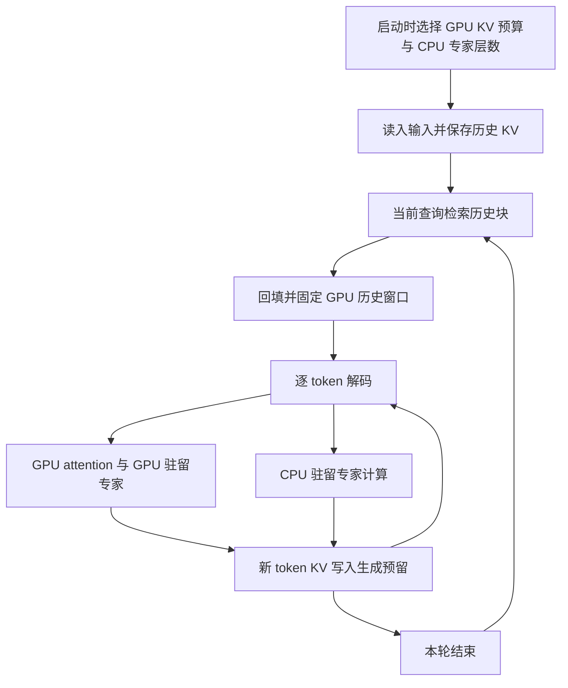

# MoE + KVMem：以 GPU KV 工作集换取专家驻留

本文描述 `moe-kv-offload` 分支已经实现的机制、测试方法和历史实测结果。文档整理于 2026-09-27；性能数据来自 2026-09-23 开始的 Alienware 实验。本次发布没有重新运行 GPU 性能基准。

核心结果：在 RTX 3080 Ti Laptop 16 GiB 上，Qwen3-30B-A3B-Instruct-2507 Q4_K_M 的 256K 实验中，完整 GPU KV、全部专家 CPU 的基线为 4.32 tok/s；64K GPU 历史窗口加 4K 生成预留、28 层专家 GPU 的配置为 14.10 tok/s。后续对双方分别调参后，保留显存余量的 KVMem 配置为 13.901 tok/s，原生配置为 4.535 tok/s，比例为 3.07x。

这些倍率同时包含 attention 工作集缩小和专家放置变化，不能解释为相同完整 attention 计算下的纯搬运加速。质量检查只有两条历史事实，不能据此证明长上下文任务质量等价。

## 1. 代码来源与实现范围

| 层级 | 来源 / 版本 | 职责 |
|---|---|---|
| 推理底座 | `ggml-org/llama.cpp`，`b81c99b479d4c24e5eeca10de99032ebd343ef8f` | GGUF 加载、量化、attention、路由、专家计算及 CPU/GPU 调度 |
| KVMem 基线 | `kvmem/kvmem-llama.cpp`，`b36dc37392814f4c16b03668b95956c6c81d64d7` | CPU 历史仓库、检索、受限 GPU KV 工作集和服务端 |
| 本分支适配 | `moe-kv-offload` | Qwen3 MoE 捕获点、专家放置参数、纯 attention 状态恢复修复 |

固定 llama.cpp 子模块指针，通过 `scripts/apply-patches.sh` 应用维护中的补丁；不需要发布另一个 llama.cpp fork。重放后的子模块显示本地修改属于预期状态。

已验证模型是 **Qwen3-30B-A3B-Instruct-2507**。这是 `qwen3moe` 的适配，不代表所有 MoE 架构均已验证。Qwen3.8-27B 的 dense/hybrid 实验不属于本文结果。

当前边界：CPU RAM 历史存储、单请求单 slot、按层静态专家放置。没有动态单专家缓存、运行时自动 KV/专家预算控制、SSD/NVMe serving 卸载，也没有 MoE MTP 验证。仓库中底层 NVMe 存储类的存在不代表本实验启用了 SSD 路径。

## 2. 为什么可以“KV 换专家”

显存约束可写为：

```text
GPU 显存 = 非专家权重 + GPU 专家权重 + GPU KV 池 + 计算缓冲及运行时开销
```

完整长历史 KV 占据显存时，只能把更多专家放在 CPU。KVMem 将历史容量与 GPU attention 工作集分开：历史保存在 CPU RAM，针对当前查询选出有限历史块供 GPU attention 使用。释放的显存用于在启动时安排更多专家层驻留 GPU。

本模型 Q8_0 K/V 的 KV 池容量为每 token 51 KiB，包含量化块开销。权重量化 Q4_K_M 与 KV 精度是两个独立设置。

| 256K 示例 | 原生基线 | KVMem 联合配置 |
|---|---:|---:|
| 逻辑上下文上限 | 262,144 | 262,144 |
| 实际输入 token | 260,992 | 260,992 |
| GPU 历史预算 | 完整上下文 | 65,536 |
| 单独生成预留 | 包含在完整池内 | 4,096 |
| GPU KV 池容量 | 12.75 GiB | 3.39 GiB |
| CPU / GPU 专家层数 | 48 / 0 | 20 / 28 |

KV 池差约 9.36 GiB，使 28 层专家可以驻留 GPU。不是所有释放字节都必须变成专家权重，还需要保留缓冲和显存余量。两组整卡显存峰值仍分别为 15.35、15.30 GiB。

这里的“专家层”是一层内整组 routed expert 张量的放置单位，不是单个专家。模型的路由规则、激活专家数量和专家权重没有改变。

## 3. 请求生命周期与数据流



### 3.1 启动时分配

`--cpu-moe` 将全部 routed experts 放 CPU；`--n-cpu-moe N` 将前 N 层的 routed experts 放 CPU，其余层按常规 GPU 放置。配合 `-ngl 99`，attention、router 等非专家部分保持 GPU 放置。两参数同时出现时 `--cpu-moe` 优先；N=0 不启用该覆盖。

这次“将专家加载回 GPU”发生在比较不同启动配置时，不是在同一服务进程内实时迁移。GPU 窗口大小和专家层数由人工/脚本联合搜索确定。

### 3.2 读入与检索

初次长输入仍需实际 prefill。KVMem 保存历史 KV 及检索元数据；当前查询选择历史块后，将所选内容组成 GPU 工作集。历史块可以来自远处，窗口不等于仅保留最后 W 个 token。attention 保留原始位置。

保存完整历史并不等于每个生成 token 都对完整历史做 attention。未选中的历史暂不参与当前固定窗口内的 attention，这是潜在质量损失的来源。

### 3.3 固定窗口解码

工作集构建完成后，当前检索窗口被固定，后续 token 复用它。新 KV 追加到生成预留区；一轮生成受 `kvmem-gen-reserve` 约束，当前实现不应被当作能自动无限扩展生成区。

CPU 驻留专家在常规单 token decode 下通常由 CPU 执行；GPU 专家在 GPU 执行。大 batch prefill 的 backend 调度可能把部分 CPU 权重算子卸载到 GPU，因此不能概括为“prefill 全 GPU、decode 全 CPU”。

大块历史 KV 回填集中于窗口构建阶段，不是每个 decode step 都回填完整历史。固定窗口 decode 中没有必然持续发生的“大块 KV 回填与专家结果搬运竞争”。如果未来加入异步刷新、多请求或专家分页，需要重新通过时间线确认重叠和竞争。

## 4. 代码改动

| 文件 | 改动 |
|---|---|
| `patches/qwen3-moe-upgrade.patch` | 在 `qwen3moe.cpp` 增加 Q/K/V 捕获调用；Q/K 在 normalization 后、RoPE 前捕获 |
| `patches/llama-kvmem-current.patch` | 将相同 MoE hook 纳入对固定 pin 的完整补丁 |
| `tools/kvmem-server-options.h`、`tools/kvmem-server-env.h` | 参数、别名、环境变量及输入验证 |
| `tools/llama-kvmem-server.cpp` | 复用 `llm_ffn_exps_cpu_override()`、`llm_add_n_cpu_ffn_overrides()` |
| `tools/kvmem-multimodal-server.h` | 仅为 recurrent/hybrid 模型保存 recurrent checkpoint |
| `scripts/apply-patches.sh` | 支持从原 KVMem 树增量升级及重复执行 |
| `tests/server-options-test.cpp` | 扩展已有参数测试 |

状态恢复修复是正确性要求：纯 attention 模型的 partial-state 序列化仍可能保存完整 attention KV；恢复时压紧 KV cells，会与 KVMem 的 slot map 不一致。当前只对 recurrent/hybrid 模型使用该 checkpoint，纯 attention 回滚删除未提交行并维持已有布局。

第一项适配提交相对 KVMem 基线为 10 个文件、153 行增加、10 行删除，包含文档、测试及两份补丁文本。llama.cpp 中模型 hook 本身只有 3 行新增；路由和专家 kernel 复用底座实现。

## 5. 实验方法

### 5.1 固定环境

- GPU：RTX 3080 Ti Laptop，16 GiB；CPU：i9-12900HK；物理 RAM：64 GB，WSL 可见约 62 GiB。
- WSL2 Ubuntu 22.04；CUDA compiler 13.2.86；SM86；Release；Flash Attention；启用全部 KV 量化组合。
- 模型：`bartowski/Qwen_Qwen3-30B-A3B-Instruct-2507-GGUF`，文件 `Qwen_Qwen3-30B-A3B-Instruct-2507-Q4_K_M.gguf`。
- 模型 revision：`6c6e8692f43e4ca663f7ece8229a1361090d3a4c`；文件大小 18,632,183,808 bytes。
- 模型 SHA256：`382b4f5a164d200f93790ee0e339fae12852896d23485cfb203ce868fea33a95`。
- 模型从 hf-mirror 下载，下载时清除代理；测试复用同一文件。
- 单请求串行、单 slot；主结果关闭 MTP/投机；默认 CUDA fusion；K=1024，GiB=2^30 bytes。

### 5.2 负载与计时

使用固定合成长文输入，约 18%、43% 位置分别埋入 `COPPER-HERON-731` 和 `SILVER-MAPLE-284` 两条事实。性能请求要求生成工程说明；生成后再追问这两条事实。归档输入见 [inputs](../benchmarks/moe-kv/inputs)。这是吞吐实验加召回 smoke test，不是 RULER 正式评测，也不是此前 300 样本 NIAH 计划的结果。

1. 每个最终配置启动新进程并短请求预热。
2. 相同长输入生成三轮：第一轮完整冷 prefill，后两轮复用前缀，从相同输入重新生成。
3. 初始 64K/128K 实验实际输入 65,401 / 130,937 token，每轮输出 256 token。
4. 256K 实验实际输入 260,992 token，每轮输出 512 token；temperature=0、seed=42、统一模板、thinking 关闭。
5. decode 报三轮中位数；冷 prefill/冷 TTFT 各只有一次观测。保留较慢的轮次。
6. 原生基线关闭自动 fit 和 context shift，防止通过缩短上下文获得虚假速度。

初始 64K/128K 消融使用同一个 `llama-kvmem-server` 开关 KVMem；256K 原生对照单独编译未经补丁修改的 `llama-server`，与适配版使用同一个 llama.cpp pin 和工具链。

256K 吞吐同时以服务端计时和客户端 SSE 首尾间隔复核。原生首 token 来自 prefill，服务端计 511 个 decode 步；KVMem 输出前执行一次 decode，计 512 步。客户端统一按 511 个间隔核对，历史六次测量差异小于 0.1%。前缀命中不等于零 prefill：后续 KVMem 调参中通常重放 49 个查询 token。

### 5.3 内存与筛选

每 0.5 秒采样整卡显存、GPU 利用率/温度/功率、服务进程 RSS、WSL total-minus-available 和 swap。后续调参增加进程 VmSwap 与时钟信息。RSS 包含 CPU 专家、CPU KV 和其他缓冲，不能全部称为 CPU KV 占用；整卡显存也不是纯 GPU KV 占用。

峰值覆盖请求和召回，不含模型加载。短请求只作容量探测，最终排名必须实际完成长 prefill。通过有限范围搜索 KV 精度、历史窗口、CPU 专家层数、线程数和 ubatch 寻找候选，不声称全局最优。

## 6. 实测结果

### 6.1 拆分 attention 与专家放置收益

以下配置使用 Q8_0 K/V、6 个 CPU 线程，generation reserve 为 4K。

| 输入档位 / 配置 | CPU/GPU 专家层 | 冷 prefill tok/s | Decode 中位 tok/s | 两条事实 |
|---|---:|---:|---:|---:|
| 64K，完整 GPU KV | 20/28 | 524.21 | 14.35 | 2/2 |
| 64K，KVMem 16K，专家位置不变 | 20/28 | 686.86 | 26.90 | 2/2 |
| 64K，KVMem 16K，联合放置 | 14/34 | 735.07 | 31.40 | 2/2 |
| 64K，KVMem 32K，联合放置 | 16/32 | 578.48 | 22.53 | 2/2 |
| 128K，完整 GPU KV | 30/18 | 323.91 | 7.99 | 2/2 |
| 128K，KVMem 16K，联合放置 | 14/34 | 709.43 | 30.62 | 2/2 |

64K 在专家位置不变时，从 14.35 增至 26.90 tok/s；在同样 16K 工作集下增加 6 层 GPU 专家，再增至 31.40 tok/s，额外提升 16.7%。联合比例为 2.19x，两个百分比不能直接相加。

这是实际生成实验，配置间输出可能不同，不能视为完全固定 token/路由轨迹的算子微基准。原始摘要见 [ablation.json](../benchmarks/moe-kv/data/ablation.json)。

### 6.2 256K：全部专家 CPU 对比 64K 工作集

两组权重 Q4_K_M、KV Q8_0、线程 6、batch/ubatch=512、无 MTP；三轮均输出 512 token。

| 指标 | 原生：CPU/GPU 48/0 | KVMem：64K+4K、CPU/GPU 20/28 |
|---|---:|---:|
| Decode 三轮 tok/s | 4.34 / 4.32 / 4.31 | 14.10 / 14.23 / 12.54 |
| Decode 中位 tok/s | 4.32 | 14.10 |
| 冷 prefill tok/s | 194.87 | 360.80 |
| 冷 TTFT 秒 | 1339.59 | 725.12 |
| 前缀命中 TTFT 中位秒 | 0.63 | 3.34 |
| 冷请求总耗时秒 | 1457.27 | 761.33 |
| 前缀命中请求总耗时中位秒 | 119.00 | 41.67 |
| 整卡显存峰值 GiB | 15.35 | 15.30 |
| 进程 RSS 峰值 GiB | 17.41 | 20.77 |
| WSL 使用峰值 GiB | 18.61 | 21.95 |
| 两条事实 | 2/2 | 2/2 |

联合 decode 比例 3.26x，包含 attention 与专家放置两种收益。窗口构建使前缀命中 TTFT 上升，不能只用 decode 比例推断所有请求的端到端收益。见 [full256-comparison.json](../benchmarks/moe-kv/data/full256-comparison.json) 和 [计时复核](../benchmarks/moe-kv/data/full256-validation.json)。

### 6.3 双方调参后的 256K 对照

原生最终配置：完整 256K GPU KV、K=q4_0/V=q8_0、CPU/GPU 专家 40/8、threads=10、ubatch=512，三轮 4.535 / 4.536 / 4.529 tok/s，中位 4.535。

KVMem 搜索包含 20 个完成配置、60 次生成测量。下表为各窗口的代表候选，保留质量失败项；它们的精度、线程和专家放置不完全相同，不是只改变窗口的消融。

| GPU 历史+生成预留 | K/V | CPU/GPU 专家 | 线程/ubatch | Decode tok/s | 对原生倍率 | GPU峰值 GiB | RSS峰值 GiB | 两条事实 |
|---|---|---:|---:|---:|---:|---:|---:|---:|
| 16K+4K | q4/q8 | 11/37 | 4/256 | 34.050 | 7.51x | 15.47 | 15.03 | 1/2，失败 |
| 32K+4K | q4/q8 | 15/33 | 6/512 | 22.269 | 4.91x | 15.04 | 16.48 | 1/2，失败 |
| 64K+4K | q8/q8 | 20/28 | 4/512 | 14.064 | 3.10x | 15.42 | 21.14 | 2/2 |
| 128K+4K | q4/q8 | 26/22 | 6/512 | 7.958 | 1.75x | 15.07 | 20.21 | 2/2 |

独立新进程复测的 16K 速度优先配置为 **33.924 tok/s**，仍只通过 1/2 召回，不能视为质量等价的 7.48x 加速。

保留更多显存余量的最终候选是 **64K+4K、q8/q8、CPU/GPU 21/27、threads=4、ubatch=512**：三轮 13.797 / 13.901 / 13.932，中位 **13.901 tok/s**；冷 prefill 353.64 tok/s；冷 TTFT 740.32 秒；前缀命中 TTFT 3.59 / 3.57 秒；显存峰值 15.06 GiB，RSS 峰值 21.51 GiB。相对调参后原生配置为 **3.07x**。

两边使用不同 KV 精度，且 KVMem 使用检索子集。因此这是各自在所测资源和基本召回约束下的配置比较，不是同精度、全量 attention 数学等价的框架排名。见 [原生最终摘要](../benchmarks/moe-kv/data/native-final.json)、[20 个配置摘要](../benchmarks/moe-kv/data/kvmem-cases)、[排序 CSV](../benchmarks/moe-kv/data/kvmem-ranking.csv)。

## 7. 正确性验证与已知限制

- 既有测试覆盖参数解析、环境变量优先级、非法整数和 CPU KV 存储。
- 状态恢复修复后的多轮检查中，抽样层已回填的 packed K/V 与历史数据一致；见 [checkpoint-regression.json](../benchmarks/moe-kv/data/checkpoint-regression.json)。
- 历史短上下文固定 token 序列的 27 个预测位置检查：关闭 CUDA fusion 时 F16/Q8 retrieval 路径与基线 logits 逐值一致；默认 fusion 下 top-1 为 27/27 一致，但 logits 不完全相同。Q/K capture 会影响融合选择。性能测量使用默认 fusion，不能用关闭 fusion 的诊断结果为性能路径声称逐位一致。
- 256K 初次正式启动的短预热出现过一次 CUDA `illegal instruction`；相同参数重启后完成测量，根因尚未定位。另有原生调参中的激进算子卸载候选失败，不能把这些失败候选当作可用最优配置。
- 原始失败日志和完整 SSE/内存采样未放入本次轻量归档。归档摘要不替代完整原始记录或独立复现。
- 两条事实召回不足以覆盖多针、跨段推理、代码依赖或 agent 成功率；保存历史不保证检索到全部相关信息。
- 有限次数笔记本测量受温度、功耗、桌面占用影响；未完成长期稳定性验证。

## 8. 复现与分支验证

详细命令、历史脚本路径要求、模型校验和归档校验见 [实验材料说明](../benchmarks/moe-kv/README.md)。设计文件中的结果表对应归档数据，不是估算值。

本次发布检查包括：从固定 pin 应用补丁、重复应用、与已测试本地快照逐文件核对、CPU 存储测试、已有服务端参数测试，以及归档输入/中位数/质量标志核对。当前发布环境没有 CUDA compiler，本次没有重新构建 CUDA 服务端或复测 GPU 吞吐；历史 CUDA 编译和实机验证与本次检查分开记录。

## 9. 后续研究，不属于已实现功能

1. 固定 KV 工作集，进一步按单专家而非整层安排驻留，测量额外驻留一个专家的实际收益。
2. 在回答质量约束下比较一个 KV block 与专家驻留的收益，而不只是回收空闲预留。
3. 在轮次边界决定是否调整预算，将检索、回填、权重迁移及未来输出长度纳入整轮成本。
4. 用 RULER、长文推理和 agent 任务测质量/延迟/吞吐曲线；比较相同质量目标下的配置。
5. 若 CPU RAM 同时承载专家和历史后不足，再研究 SSD 冷历史层。当前不需要假设每个 decode step 都发生大块 KV 与专家搬运竞争。

“KV 换专家”和联合内存分配本身已有相关公开工作；本分支是可复现的实现与实验基础，不提出首次实现或已完成动态联合优化的主张。
